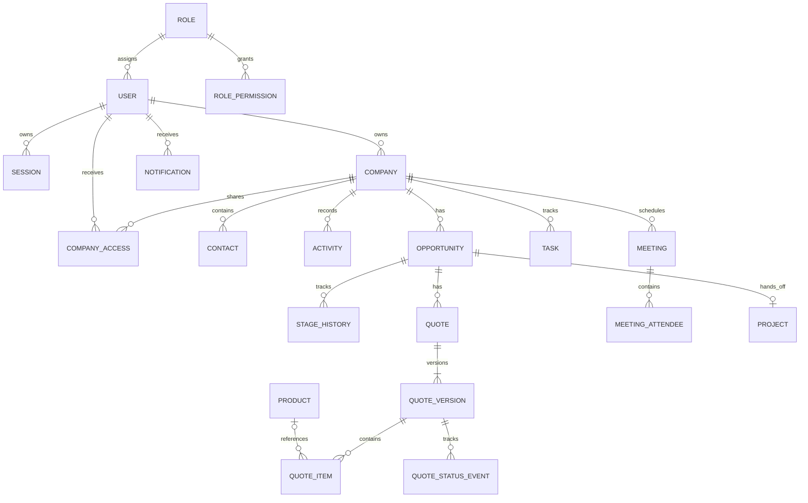

# Mimari ve veri modeli

## Yapı

`apps/web`: Next.js App Router, TypeScript. `apps/api`: NestJS REST API. `packages/shared`: Zod sözleşmeleri. PostgreSQL/Prisma; tek API içinde modüler monolit. İş modülleri Faz 1'den itibaren eklenecek.

Web ve API üretimde aynı origin arkasında sunulur: `/api/*` API'ye, diğer yollar web'e. Yerelde Next rewrite kullanılır. Cookie auth Faz 1'de uygulanır; geniş CORS veya sahte oturum kullanılmaz. API doğrulaması için Zod seçildi. OpenAPI dekoratörleri ile runtime şemalarının uyumu testlerle korunmalıdır.

PostgreSQL outbox worker Faz 2'de; Redis yok. Private S3 ve saklanan PDF Faz 4'te. DB, dosya ve audit erişimi hizmet katmanında; sorgu kapsamı da yetkilendirilir. Hassas alanlar DTO'lara otomatik yayılmaz.

## Hedef ERD (uygulanmış şema değildir)

Faz 0 iş tabloları oluşturmaz; Prisma'da yalnız bağlantıyı sınayan teknik bir baseline tablo bulunur. İş şemaları kendi fazlarında migration ile eklenir.

## Şemaya eklenmesi gerekenler

- Davet ve parola sıfırlamada token hash, son kullanım, kullanılmış/iptal zamanı; oturumda yalnız token hash.
- `quote_items`: maliyet ve maliyet para birimi; yetkisiz DTO ve PDF'den çıkarılır.
- `quote_versions`: optimistic lock, politika snapshot'ı, otomatik/manuel onay yöntemi, içerik snapshot'ı, PDF storage key/checksum ve şablon sürümü.
- Ayrı teklif durum/onay olayları: immutable ticari içerik ile değişen operasyonel durum ayrılır.
- `opportunity_access` veya eşdeğer açık kayıt kapsamı; `task` ataması tüm firma erişimini kendiliğinden vermez.
- `meeting_attendees`: user/contact/external_email alanlarından tam biri dolu olmalı.
- İlişkili firma/fırsat/kişi aynı bağlamda olmalı; foreign key tek başına bunu sağlamaz. Uygun composite constraint ve transaction kullanılmalı.
- Paylaşımda `(company_id,user_id)` unique; sürümde `(quote_id,version_number)` unique; projede opportunity unique.
- `outbox_events`: lease/lock, retry/backoff ve dead-letter davranışı; tüketici işleminde dedupe.

## Hesap sözleşmesi taslağı

Tutarlar API'de decimal string, DB'de numeric. Miktar ve fiyat en çok 4 ondalık; yüzde 0–100. Para biriminin minor-unit hassasiyeti kullanılır. Öneri: kalem brütü → kalem indirimi → varsa teklif indiriminin kalemlere deterministik dağıtımı → net tutar → KDV → toplam. Yuvarlama modu HALF_UP; dağıtım kalanı sabit kalem sırasıyla dağıtılır. Bu algoritma Faz 4 öncesi örneklerle kesinleştirilecek.

Eksik maliyet marjı sıfır veya kârlı varsaymaz; manuel onay gerektirir. Fiyat/katalog/firma güncellemesi geçmiş snapshot'ı değiştiremez. Eski PDF depolanan dosyadan gelir; yeniden üretim geçmiş dosyanın üzerine yazmaz.
